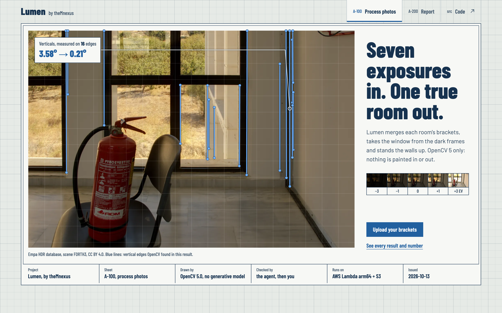
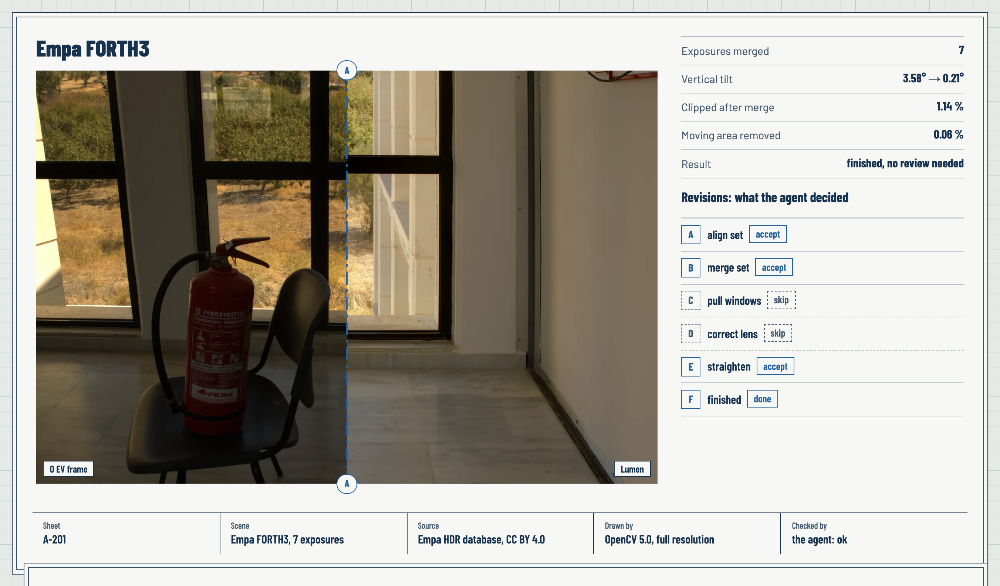
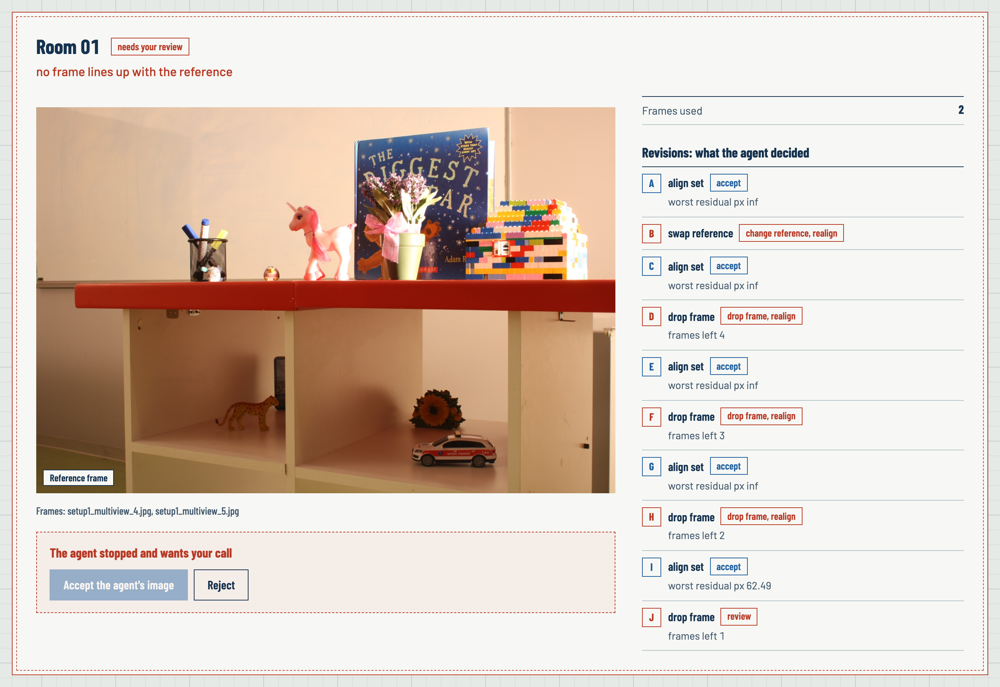
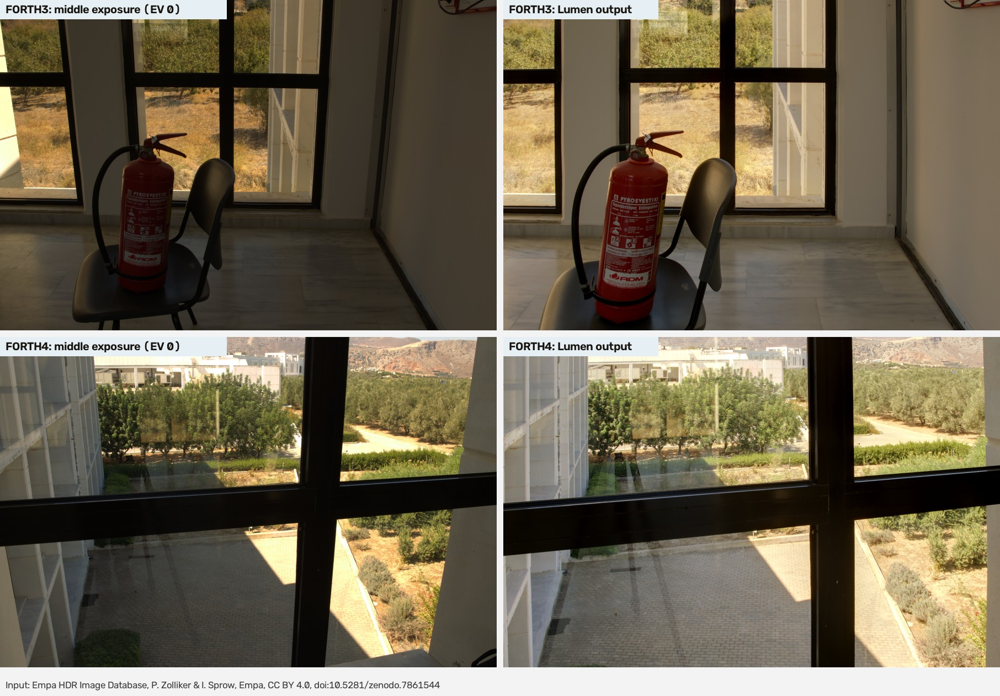

# theMnexus Lumen

**An agent that sees, fixes and checks real-estate bracket photos. OpenCV 5 does the looking; every decision is written down.**

Entry by team **theMnexus** for the OpenCV AI Competition 2026.

- **Live web app:** https://wdjobi4cdy2ucu7nw2y77ixkme0cczvb.lambda-url.ap-southeast-2.on.aws/
- **Test data:** [lumen-samples.zip](https://github.com/theMnexus/opencv26-lumen/releases/latest/download/lumen-samples.zip) (44 MB, real Empa and Cambridge brackets, CC BY 4.0), also on the [Releases](https://github.com/theMnexus/opencv26-lumen/releases) page

People who sell or rent a home often shoot it themselves. Interiors come out with dark corners and white windows, leaning walls, bent lines from wide lenses, and ghosts when someone walks through a bracket. Lumen takes a folder of bracketed photos and returns one clean image per room — and a trace that says what it saw, what it did, and when it stopped to ask a person.

Lumen only corrects optics. It never adds or removes objects, so the photo still shows the real room.

## How it works


Diagram sources: [`docs/diagrams/`](docs/diagrams/) (Mermaid `.mmd`, rendered to SVG and PNG).





### The agent loop

Every step the agent reads quality numbers produced by OpenCV, fires the first matching rule, runs one tool, measures again, then **accepts**, **reverts**, or **stops and asks a person**. The rule table is fixed, so the same photos always give the same trace.

| Rule | Sees | Does |
|---|---|---|
| need_alignment | not aligned | `align_set` |
| bad_reference | every frame misaligned to the reference | pick another reference, realign |
| bad_frame | a frame's residual above the limit | drop that frame, realign; < 2 frames left → person |
| need_merge | not merged | Mertens + ghost removal |
| too_much_motion | > 15 % of the image moves | ask a person |
| blown_window | ≥ 0.5 % clipped | pull window detail; revert if not better |
| debevec_fallback | window pull failed and EXIF has exposure times | radiance merge |
| lens | not tried | plumb-line self-calibration of `k1` |
| tilt | not tried | upright verticals; revert if the measured tilt gets worse; extreme keystone → person |
| *person* | a set is `needs_review` (or any set) | accept the agent's image, reject it, or drop a frame and re-run — recorded as the first trace step |

Example traces where an OpenCV result changes the next step: [`docs/traces/`](docs/traces/) — a stranger frame dropped (`stranger-frame`), a stranger in the reference slot recovered (`stranger-reference`), two different rooms sent to a person (`two-rooms`).

### Human review

When the agent stops (`needs_review`), the web UI shows the reason and three actions: **Accept agent's image**, **Reject**, or **Drop frame & re-run**. The choice is stored in the job and becomes the first step of the trace (`person_review`), so the record shows who decided what.



### MCP server: the same OpenCV 5 tools for other agents

`lumen-mcp` exposes seven tools over the Model Context Protocol: `group_photos`, `align_bracket`, `merge_bracket`, `correct_lens`, `straighten`, `qc_image` and `run_agent`. A coding agent such as Claude Code can measure, decide and re-run steps itself, or hand a bracket to `run_agent` and read the trace. Paths must stay inside `LUMEN_MCP_ROOT`; outputs go to `lumen-out/`.

```json
{
  "mcpServers": {
    "lumen": {
      "command": "uv",
      "args": ["run", "--directory", "/path/to/opencv26-lumen", "--extra", "mcp", "lumen-mcp"],
      "env": { "LUMEN_MCP_ROOT": "/path/to/photos" }
    }
  }
}
```

Tried with Claude Code 2.1 on a folder of 14 mixed Empa photos, with only the lumen tools allowed: it called `group_photos(["photos"])` (2 rooms), `run_agent` on each (both `ok`) and `qc_image` on the outputs, then wrote a report in 37 s. Tools take image paths or a folder.

### Where OpenCV 5 does the work

| Step | OpenCV 5 |
|---|---|
| Group | `resize`, `equalizeHist`, `dct` signature, `phaseCorrelate` on `Sobel` edge maps |
| Align | `createAlignMTB`, **`findTransformECCMultiScale` + `ECCParameters`** (new in 5.0: pyramid + masks on both images), `SIFT_create` + `findHomography` RANSAC fallback |
| Merge | `createMergeMertens`; `createMergeDebevec` + `createTonemapDrago` |
| Ghosts | `LUT`, per-channel `absdiff`, `threshold`, `morphologyEx`, `connectedComponentsWithStats` |
| Window | `connectedComponentsWithStats`, `boundingRect`, `LUT`, `GaussianBlur` |
| Lens | `Canny`, `findContours`, `undistortPoints`, `getOptimalNewCameraMatrix`, `initUndistortRectifyMap`, `remap` |
| Tilt | `createLineSegmentDetector`, `perspectiveTransform`, `pointPolygonTest`, `warpPerspective` |
| QC | `phaseCorrelate` per tile (alignment residual), `createHanningWindow`, clip ratios, MEF-SSIM |

## Results

Full tables: [`docs/RESULTS.md`](docs/RESULTS.md) (generated by `bench/run.py`). Synthetic brackets with known answers, two camera profiles (`clean` and `phone`: S tone curve, noise σ 5, JPEG 75, ±5 % exposure error), seeds 3–6, 24 sets per profile.

| What | Result (both profiles) |
|---|---|
| Grouping, exact set match | 100 % (with and without EXIF) |
| Alignment error vs. truth | ≤ 0.26 px, ECC on 100 % of frames |
| Ghost false alarms | ≤ 0.03 % of the image; recall ≈ 0.81 |
| Window clipping | 0.94 → ≤ 0.003 |
| Lens `k1` within 10 % (focal length known) | 48/48 — the shipped agent guesses focal = image width: `k1` then differs (×1.56) but the straightened lines match the known-focal result within 20 % |
| Tilt error | ≤ 0.12°, residual tilt ≤ 0.18° |
| Agent: normal sets / stranger frame / stranger reference / two rooms | 48/48 · 48/48 · 48/48 · 48/48 |
| 24 MP, one set of 5 frames, MacBook | 10.8 s, 7.5 GB peak |
| 24 MP folder, 45 frames / 15 sets, MacBook | 131 s, 5.9 GB peak (sets are processed one at a time) |

**Real brackets.** Three scenes from the [Empa HDR Image Database](https://zenodo.org/records/7861544) (Canon/Nikon RAW, converted with `bench/raw_to_jpeg.py`). No ground truth exists, so these rows report what the agent did:

| Empa scene (CC BY 4.0) | Frames | Agent | Ghost flagged | Tilt before → after | Time (16 MP, MacBook) |
|---|---|---|---|---|---|
| FORTH3 — room with a bright window | 7 (EV −3…+3) | ok | 0.06 % | 3.58° → 0.21° | 10.3 s |
| FORTH4 — looking out through a window | 7 (EV −3…+3) | ok | 0.06 % | 5.55° → 0.42° | 10.4 s |
| Museum1 — dark room, exposures up to 8 s | 7 (EV −3…+3) | ok | 0.00 % | 0.52° → 0.13° | 5.6 s |

Grouping on the real frames: 100 % exact.

**Ghost removal on real brackets with an answer.** The [Cambridge deghosting dataset](https://www.repository.cam.ac.uk/handle/1810/261766) (Karaduzovic-Hadziabdic, Hasic Telalovic, Mantiuk; CC BY 4.0) has 36 real 5-exposure scenes, each shot twice: with people or objects moving, and without. Lumen merges the moving bracket with ghost removal on and off and compares both with the motion-free merge (`bench/ghost_real.py`, [`docs/RESULTS-ghost.md`](docs/RESULTS-ghost.md)):

| | Ghost removal off | on |
|---|---|---|
| PSNR vs motion-free merge (mean of 36) | 29.41 dB | **34.80 dB** (+5.39) |
| SSIM (mean) | 0.923 | **0.963** |
| Scenes better / same / worse | | 28 / 7 / 1 (solm-4, −1.4 dB) |

The agent finished 27 of 36 and asked a person on 9: four with more than 15 % of the frame moving (it still merged them, +7 to +13 dB), four where the camera moved between shots (multiview; no homography fits parallax), one with a 1.78 keystone.




## Run it

Requires Python 3.12 and [uv](https://docs.astral.sh/uv/). Every dependency is pinned in `uv.lock`.

```bash
uv sync                                         # install (OpenCV 5.0.0.93); add --extra mcp for the MCP server
uv run pytest -q                                # tests
uv run python -m lumen.synth out/demo --sets 3  # synthetic brackets with truth.json
uv run uvicorn lumen.api:app --port 8765        # web UI at http://localhost:8765
uv run python bench/run.py                      # regenerate docs/RESULTS.md
uv run python bench/fetch_empa.py FORTH3 FORTH4 Museum1   # real brackets (CC BY 4.0) -> data/empa/jpg
uv run python bench/run.py --real data/empa/jpg          # + real brackets (one subfolder per set)
uv run python bench/fetch_cambridge.py                    # 36 real scenes with motion + motion-free answer (CC BY, 3.9 GB)
uv run python bench/ghost_real.py data/cambridge/jpg      # docs/RESULTS-ghost.md
uv run python bench/make_samples.py                       # out/lumen-samples.zip: the public sample pack
uv run python bench/build_web_assets.py                   # web UI result images + report.json for the Report sheet
```

### Container and AWS

```bash
docker build --platform linux/arm64 -f infra/Dockerfile.arm64 -t lumen:arm64 .
docker run --rm -p 9000:8080 -e LUMEN_STORAGE=local -e LUMEN_DATA_DIR=/tmp/store lumen:arm64
uv run python infra/container_smoke.py out/demo     # drives the container like a Function URL

bash infra/deploy.sh                                # SAM: Lambda arm64 + S3 + Function URL + CloudWatch
```

`infra/template.yaml`: private encrypted bucket with 7-day expiry, Lambda arm64 (template default 10 GB, deployed at 3008 MB; 15 min), public Function URL, optional reserved concurrency, least-privilege IAM (own bucket, self-invoke only), 14-day logs.

**Live demo:** https://wdjobi4cdy2ucu7nw2y77ixkme0cczvb.lambda-url.ap-southeast-2.on.aws/ (Lambda arm64 in ap-southeast-2, 3008 MB: the account's limit). On a real 7-frame 16 MP bracket (Empa FORTH3) the worker finished in 18.3 s using 1362 MB, about 54 GB-s or US$0.0007 per room. When a set would not fit the function's memory, frames are shrunk evenly first (`jobs.load_set`, from `AWS_LAMBDA_FUNCTION_MEMORY_SIZE`): without that, the same set ran out of memory at 3008 MB.

## Code map

```
src/lumen/  io · group · align · merge · window · lens · tilt · qc · agent · jobs · store · api · mcp_server · web/ · synth
tests/      one test file per module + phone-profile regression tests
bench/      run.py -> docs/RESULTS.md, docs/RESULTS-synthetic.csv, docs/traces/*.json
infra/      Dockerfile.arm64, template.yaml (SAM), deploy.sh, container_smoke.py
docs/       REPORT.md (technical report), RESULTS.md, RESULTS-ghost.md, traces/, diagrams/, screenshots/
```

## Limits

- Ground-truth numbers come from synthetic rooms; the three real Empa brackets have no ground truth and are still few.
- Lens self-calibration fits `k1` only; fisheye lenses are not handled.
- Ghost recall is about 0.81 on synthetic rooms: a low-contrast edge of a moving object can survive. On 36 real Cambridge scenes ghost removal helped in 28, did nothing in 7 and cost 1.4 dB in one.
- Grouping relies on capture time: staged brackets with minutes between shots (the Cambridge set) split; tick *These photos are one bracket* in the UI (API `one_bracket: true`) to skip grouping.
- Very strong keystone (> ~15° pitch) and scenes with more than 15 % motion are sent to a person on purpose.

## Responsible use

- Only pixels the camera recorded are used; no generative fill, no object removal.
- Every change is listed in the trace with numbers before and after.
- Uncertain cases stop with `needs_review` instead of guessing.
- Uploaded photos expire from S3 after 7 days.

## Data credits

Real test brackets, both CC BY 4.0. The full-size images are not stored in this repository; the fetch scripts download them. The web UI ships small resized results built by `bench/build_web_assets.py`, and `bench/make_samples.py` builds the resized sample pack, both with this attribution.

- Empa HDR Image Database, P. Zolliker & I. Sprow, Empa, doi:10.5281/zenodo.7861544 (`bench/fetch_empa.py`).
- Multi-exposure image stacks for testing HDR deghosting methods, K. Karaduzovic-Hadziabdic, J. Hasic Telalovic, R. K. Mantiuk, University of Cambridge, doi:10.17863/CAM.6881; paper: Computers & Graphics 63 (2017) 1–17 (`bench/fetch_cambridge.py`).

Technical report: [`docs/REPORT.md`](docs/REPORT.md).
