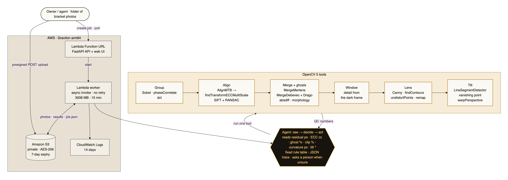
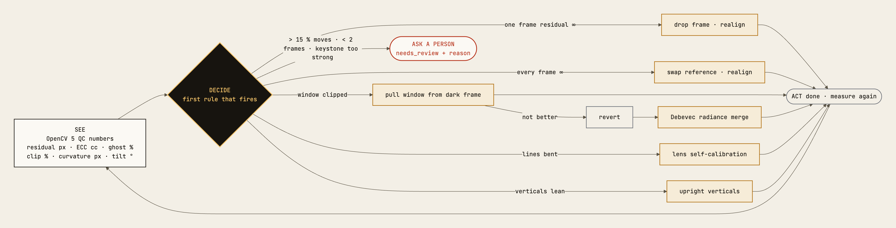

# theMnexus Lumen — Technical Report

OpenCV AI Competition 2026 · team **theMnexus** · code: this repository · numbers: [`RESULTS.md`](RESULTS.md) · video: https://youtu.be/p_b2utDpR-c

## 1. Problem

Listing photos sell and rent homes. A good interior photo needs three exposures merged, straight verticals and no lens bend — work a professional editor does by hand. Owners, small agents and new photographers shoot brackets but cannot afford that editing, so listings go online with black corners, white windows, leaning walls, bent door frames, and double ghosts of someone who walked through.

Generative "AI enhance" apps fix the look by repainting the room. For a listing that is a problem: the photo is a promise about a real property.

**Goal:** from a folder of bracketed shots, produce one correct image per room using only the pixels the camera recorded, and say exactly what was changed and when a person must look.

## 2. Users

| User | Needs |
|---|---|
| Owner selling or renting | Upload a phone/camera folder, get usable photos, no editing skills |
| Small agent / new photographer | Batch of rooms, consistent result, a list of shots to retake |
| Reviewer (platform, broker) | Proof that nothing in the room was invented: the trace |

## 3. Architecture

Source: [`diagrams/architecture.mmd`](diagrams/architecture.mmd).

A job moves `uploading → queued → running → done | failed`. The API answers immediately; a second, asynchronous invocation does the work and writes `job.json`, which the browser polls. Locally the same code runs with a folder instead of S3 (`LUMEN_STORAGE=local`).

## 4. OpenCV 5: where the vision work happens

Every decision in the pipeline comes from an OpenCV 5 measurement. Decode, resize and encode are the least of it.

| Step | What OpenCV 5 computes | Why it matters |
|---|---|---|
| **Group** | `equalizeHist` + `Sobel` edge maps → `phaseCorrelate` response between neighbours; `dct` signature as a second opinion | Splits a folder into brackets even without EXIF. Same room ≥ 0.459, different room ≤ 0.320 (threshold 0.40). |
| **Align** | `createAlignMTB` start → **`findTransformECCMultiScale`** with `ECCParameters` (4 pyramid levels, homography, masks that drop clipped pixels in *both* images — new in OpenCV 5) on blurred gradient maps → `SIFT_create` + `findHomography` RANSAC fallback | Exposure-invariant sub-pixel alignment: ≤ 0.26 px error. |
| **Alignment QC** | 4 × 4 tiles, `createHanningWindow` + `phaseCorrelate` per tile → median residual; share of tiles that correlate; ECC correlation coefficient | Tells the agent whether a frame belongs: a frame from another room gives ∞. |
| **Merge** | `createMergeMertens`; `createMergeDebevec` with the sRGB response + `createTonemapDrago` | Two engines the agent chooses between (Debevec keeps window detail). |
| **Ghosts** | per-channel exposure matching with `LUT`, `absdiff` where each channel is well exposed, `threshold`, `morphologyEx`, `connectedComponentsWithStats` | Moving people/objects appear once, where the reference saw them. |
| **Window** | blown blobs via `connectedComponentsWithStats`, `boundingRect`, `createMergeMertens` on the darker frames inside the window box, feathered blend | Sky and trees come back as one picture: window clipping 0.94 → ≤ 0.05. |
| **Lens** | `Canny` + `findContours` edge chains split at corners → plumb-line cost after `undistortPoints` → `getOptimalNewCameraMatrix` + `initUndistortRectifyMap` + `remap` | Self-calibrates barrel distortion from the room's own straight lines. With the focal length known, `k1` lands within 10 % on 48/48 sets; the agent guesses focal = image width, which changes the reported `k1` but leaves line straightness within 20 % of the known-focal result. |
| **Tilt** | `createLineSegmentDetector` → vertical vanishing point (eigenvector of Σ w·l·lᵀ) → upright homography → zoom fit with `perspectiveTransform` + `pointPolygonTest` → `warpPerspective` | Removes roll and keystone; roll error ≤ 0.12°. |

Verified in a test (`tests/test_opencv5.py`): the build runs OpenCV 5.0.0 and every function above exists.

## 5. AWS

| Part | Choice | Reason |
|---|---|---|
| Compute | Lambda container image, **arm64 (Graviton)**, deployed at 3008 MB (account limit; template default 10 GB), 15 min, 4 GB `/tmp` | Frames shrink evenly to fit the memory (`jobs.load_set`); 24 MP × 5 frames peaked at 7.5 GB locally; a 45-frame 24 MP folder took 131 s at 5.9 GB because the worker groups on 1/4-size decodes and processes one set at a time |
| API | Lambda Function URL + FastAPI via Mangum | One public URL for the UI and the API |
| Long work | async self-invoke (`InvocationType=Event`), no retries | A 24 MP set takes 7–11 s; the browser polls; a worker killed by time or memory is reported `failed` after 16 min instead of hanging |
| Storage | S3: private, AES-256, 7-day lifecycle, CORS for presigned POST/GET | Uploads bypass the 6 MB Function URL payload limit |
| Observability | CloudWatch log group, 14 days; per-step trace in `job.json` | Every decision is inspectable |
| Safety | reserved concurrency (off on accounts limited to 10); least-privilege IAM (own bucket + self-invoke) | Caps cost and abuse of a public demo |
| Reproducible | `infra/template.yaml` (SAM), `infra/deploy.sh`, image pinned with hashes from `uv.lock` | One command to rebuild |

The container was built for `linux/arm64` and driven through the Lambda Runtime Interface Emulator with Function URL events (`infra/container_smoke.py`): a 9-photo job finished in 4.8 s inside the container.

**Deployed** (https://wdjobi4cdy2ucu7nw2y77ixkme0cczvb.lambda-url.ap-southeast-2.on.aws/, ap-southeast-2, 3008 MB). Real run, Empa FORTH3 (7 × 16 MP): upload 9.6 s from Vietnam, processing 21.7 s, Lambda 18.3 s at 1362 MB peak ≈ 54 GB-s ≈ US$0.0007 per room. Two problems showed up only on AWS and were fixed: the first run ran out of memory at 3008 MB (frames now shrink to the memory budget), and presigned uploads to the global S3 host got a 307 for a bucket outside us-east-1 (regional endpoint now).

## 6. How it was measured

Real interiors do not come with ground truth, so `src/lumen/synth.py` draws rooms and applies **known** faults: camera shake (homography), lens `k1`, roll, a moving object, bracket exposures and a window that clips at EV 0. Two camera profiles:

- `clean`: exact gamma 2.2, noise σ 1.5, JPEG 92.
- `phone`: per-channel S tone curve, noise σ 5, JPEG 75, real exposure ±5 % off the EXIF value — built specifically to break the gamma assumptions inside merge/window.

Honest note on tuning: several thresholds were chosen from measurements on these same seeds (the failure table below says which). The synthetic numbers therefore show that each step works as designed, not how it generalises. The independent test is real camera brackets that played no part in building the pipeline: three scenes from the Empa HDR Image Database (below).

`bench/run.py` runs seeds 3–6 × 6 sets × 2 profiles and injected faults; headline numbers:

| What | clean | phone |
|---|---|---|
| Grouping exact match (EXIF / image only) | 100 % / 100 % | 100 % / 100 % |
| Alignment error, worst | 0.25 px | 0.26 px |
| Ghost false alarm, worst / recall mean | 0.03 % / 0.81 | 0.03 % / 0.81 |
| MEF-SSIM fused vs. middle frame only (mean) | 0.981 vs 0.963 | 0.972 vs 0.949 |
| Window clipping after, worst | 0.0021 | 0.0459 |
| Lens k1 within 10 % (focal known; agent uses a width guess) | 24/24 | 24/24 |
| Roll error, worst | 0.11° | 0.12° |
| Agent correct on normal sets | 24/24 | 24/24 |
| Stranger frame dropped / stranger reference recovered / two rooms → person | 24/24 · 24/24 · 24/24 | 24/24 · 24/24 · 24/24 |

### Real brackets (Empa HDR Image Database, CC BY 4.0)

Seven-exposure RAW brackets (EV −3 to +3, 24–40 mm), decoded with rawpy and run through the full agent at 16 MP. There is no ground truth, so the table reports the agent's decisions and QC numbers (`docs/traces/real-*.json`):

| Empa scene (CC BY 4.0) | Frames | Agent | Ghost flagged | Tilt before → after | Time (16 MP, MacBook) |
|---|---|---|---|---|---|
| FORTH3 — room with a bright window | 7 (EV −3…+3) | ok | 0.06 % | 3.58° → 0.21° | 11.7 s |
| FORTH4 — looking out through a window | 7 (EV −3…+3) | ok | 0.06 % | 5.55° → 0.42° | 12.3 s |
| Museum1 — dark room, exposures up to 8 s | 7 (EV −3…+3) | ok | 0.00 % | 0.52° → 0.13° | 5.6 s |

**Ghost removal on real brackets with an answer.** The [Cambridge deghosting dataset](https://www.repository.cam.ac.uk/handle/1810/261766) (Karaduzovic-Hadziabdic, Hasic Telalovic, Mantiuk; CC BY 4.0) has 36 real 5-exposure scenes, each shot twice: with people or objects moving, and without. Lumen merges the moving bracket with ghost removal on and off and compares both with the motion-free merge (`bench/ghost_real.py`, [`docs/RESULTS-ghost.md`](RESULTS-ghost.md)):

| | Ghost removal off | on |
|---|---|---|
| PSNR vs motion-free merge (mean of 36) | 29.41 dB | **34.80 dB** (+5.39) |
| SSIM (mean) | 0.923 | **0.963** |
| Scenes better / same / worse | | 28 / 7 / 1 (solm-4, −1.4 dB) |

The agent finished 27 of 36 and asked a person on 9: four with more than 15 % of the frame moving (it still merged them, +7 to +13 dB), four where the camera moved between shots (multiview; no homography fits parallax), one with a 1.78 keystone.

Grouping exact match on the Empa frames: 100 %. Lens self-calibration was skipped on all three (no straightness gain ≥ 5 % on FORTH3/FORTH4; too few straight pieces in Museum1).

The first run on real data exposed six problems the synthetic sets had hidden; all are fixed and listed in the table below (marked *real*). A further private set of real-estate interiors (not published, no numbers reported here) was used only to find failures; the four fixes it led to are marked *private set*.

### Failure cases found while building (and fixed)

| Found | Cause | Fix |
|---|---|---|
| Residual 17 px on a perfect alignment | a moving person shifted 1–2 tiles; p90 caught it | median of tiles |
| Two different rooms "aligned" (residual 1.75 px, then 0.59 px) | ECC bends one room onto another | tile-correlation share + ECC cc limit |
| Phone profile: ECC on only 60 % of frames, 9.7 px error | equalised dark frames amplify noise; cc fell to 0.645 | 2 px blur before Sobel; cc limit 0.8 chosen on seeds 5–6 (same room ≥ 0.921, other room ≤ 0.652) |
| 24 MP: good frames dropped | residual measured at 0.25 scale, limit was in full-res px | limit in working-copy px |
| Stranger in the reference slot → `needs_review` with two good frames | every other frame looked wrong | `bad_reference` rule swaps the reference first |
| Ghost on a grey wall missed (IoU 0.04) | grey-level difference too small for a red object | per-channel difference |
| Ghost false alarms up to 62 % | 256-bin LUT bent by the moving object itself | one exposure ratio per channel (median, sRGB-linear) |
| Purple/green walls from Debevec | `CalibrateDebevec` curves disagree with 3 frames | fixed sRGB response |
| Lens k1 missed on 6/16 sets | trimmed mean dropped the long border lines | plumb-line cost over all points |
| *Real:* 11.5 % of a static tripod scene flagged as ghost (FORTH3) | one sRGB exposure ratio does not match a real tone curve at EV ±3 | quantile matching per channel: 0 % on FORTH3, synthetic recall 0.82 |
| *Real:* agent switched to Debevec and accepted MEF-SSIM 0.965 → 0.884 | "no window found" counted as a failed window pull; acceptance looked at clipping only | "no window" is a skip; Debevec must also keep MEF-SSIM within 0.05 |
| *Real:* residual tilt reported as 1.7° on a correctly straightened room | a chair and a fire extinguisher (not vertical in the world) pulled the mean | length-weighted median: 0.21° |
| *Real:* a dark-room bracket would be split in two (Museum1) | a 4 s exposure, next shot 8.7 s later; gap measured start-to-start | gap measured from the end of the previous exposure |
| *Real:* lens "corrected" from 6 glass-case edges (k1 +0.069) | too few straight pieces to trust | at least 12 pieces, otherwise skip |
| *Real:* window pull left tree-shaped dark blotches; branches looked like a negative (own room, −4…+4 EV) | blend chose the source per pixel from merged brightness: blown sky from the −4 EV frame (mean 72), unblown branches from the merged image (mean 225); acceptance looked at clipping only | the whole window region comes from one source, a Mertens fusion of the frames at or below the reference (synthetic worst clipping after rose 0.0026 → 0.046, the price of a natural sky); the agent also rejects a pull whose window has more than 5 % edges no frame recorded (`qc.foreign_edge_share`: blotchy blend 0.10–0.11, new blend ≤ 0.003 at 1500–6000 px) |
| *Private set:* static rooms flagged as moving in the darkest frame of wide (±4 EV) brackets | mapping a frame many stops up multiplies its noise | ghost limit grows with the LUT slope (28 + 8 × (slope − 1) levels) |
| *Private set:* brackets split before their brightest frame | the camera idled longer than the time between rooms | a long gap does not split when the images clearly match (phase ≥ 0.6) |
| *Private set:* lens "corrected" with k1 at the edge of the search range | no real minimum, wrong sign for a wide lens | a k1 on the search limit is not applied |
| *Private set:* straightening made a room measure more tilted | accepted any change | the agent reverts a straightening that measures worse |
| *Real, Cambridge:* a manual-mode bracket (bias 0.0 on every frame, 1/8–2 s) split into single frames | an exposure-bias repeat was read as a new set | a repeat needs the same bias **and** the same shutter time; order by both |
| *Real, Cambridge:* 2 of 36 agents stopped with "no result after 10 steps" | dropping 3 frames costs 6 steps; a flat budget of 10 ran out one step before the end | budget = 10 + 2 × frames |
| *AWS:* out of memory at 3008 MB on 7 × 16 MP | the account caps Lambda at 3008 MB | frames shrink evenly to the memory budget |
| *AWS:* browser uploads got 307 | presigned POST on the global S3 host for a bucket outside us-east-1 | regional S3 endpoint |

## 7. Limits

- Ground-truth numbers come from synthetic rooms; real rooms add texture, mirrors, plants, and phone-side local tone mapping and HDR.
- Ghost recall ≈ 0.81 on synthetic rooms: low-contrast edges of a moving object can survive. On the 36 real Cambridge scenes ghost removal helped in 28, did nothing in 7 and cost 1.4 dB in one (solm-4).
- Grouping relies on capture time; staged brackets with minutes between shots need the *one bracket* option.
- Three real scenes is a small sample; FORTH4's keystone (0.3496) sat just under the 0.35 review limit.
- Lens: one radial term (`k1`); fisheye lenses are not modelled yet.
- Strong keystone (≈ > 15° pitch at 0.8 × width focal) and > 15 % motion are sent to a person by design.
- Full-resolution Mertens dominates run time (3.4–6.7 s at 24 MP).
- COOL (the Graviton-optimised OpenCV build on AWS Marketplace) was not benchmarked; the stock OpenCV 5 wheel runs on arm64.

## 8. Responsible use

- **No invented content:** only recorded pixels are blended or warped; nothing is painted in or removed. The window pull fuses the real darker frames of the same bracket, not a sky replacement.
- **Explainable:** each set ships with a trace — what was measured, which rule fired, which tool ran, numbers before and after, and the decision.
- **A person stays in control:** too much motion, frames that do not belong, or extreme perspective stop with `needs_review` and a reason, instead of a confident wrong image.
- **Data:** uploads expire after 7 days; the bucket is private and encrypted; links are presigned and short-lived.
- **Rights:** test images are synthetic or from the Empa HDR Image Database (CC BY 4.0, credited on every published image). No customer or third-party listing photos are used.

## Agentic Vision

**See → decide → act.** OpenCV 5 tools produce numbers; the agent picks the next tool from those numbers; the new numbers decide whether to keep, revert, or ask a person.

Source: [`diagrams/agent-loop.mmd`](diagrams/agent-loop.mmd).

Trace excerpt (`docs/traces/phone-stranger-frame.json`, bright frame taken from another room):

| Step | Rule → tool | Decision | Key number |
|---|---|---|---|
| 1 | need_alignment → align_set | accept | worst residual = ∞ |
| 2 | bad_frame → drop_frame | drop frame 2, realign | residual of frame 2 = ∞ |
| 3 | need_alignment → align_set | accept | worst residual = 0.134 px |
| 4 | need_merge → merge_set | accept | ghost 0 % |
| 5 | blown_window → pull_windows | accept | clip 1.5 % before |
| 6 | lens → correct_lens | skip | no gain ≥ 5 % |
| 7 | tilt → straighten | accept | — |
| 8 | finished | done | — |

| Agentic requirement | Lumen |
|---|---|
| Output changes later steps | residual → drop/swap; clip → window → revert (no clipping gain, or seams) → Debevec; keystone → person |
| Success rate | 192/192 on normal and injected-fault cases across both profiles (§6) |
| Error handling | at most 10 + 2 × frames steps per set (`FIXED_STEPS`, `STEPS_PER_FRAME`); any exception ends the job `failed` with a message; bad uploads rejected with 400 |
| Observability | per-step JSON trace, job timing, CloudWatch logs |
| Human control | `needs_review` with a reason; in the web UI a person accepts, rejects, or drops a frame and re-runs, and that decision becomes the first trace step (`person_review`); at upload a person can switch off ghost removal, window fill, lens or tilt (never the merge), and a switched-off step is still traced as `off`; deterministic rules, so the same input gives the same trace |
| Other agents | `lumen-mcp` exposes the same OpenCV 5 tools over MCP (group, align, merge, lens, tilt, QC, run_agent), with paths locked to one root folder |
